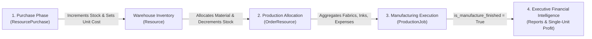

# Avenor Promotional T-Shirt Management System
# Manufacturing Cost, Resource Expense & Profit Reports — Comprehensive API Documentation

Comprehensive REST API Specification and Reference Guide for **Manufacturing Cost Accounting, Raw Material Expense Tracking, WIP & Resource Inventory, and Executive Profit Reports** of the Promotional T-Shirt Company operating two registered brands (**Premium Brand** & **Standard Brand**) under **Your Company (Pvt) Ltd**.

---

## 📑 Table of Contents
1. [System Blueprint & Architectural Foundation](#-system-blueprint--architectural-foundation)
   - [1.1 Multi-Brand Segregation & Integrity](#11-multi-brand-segregation--integrity)
   - [1.2 End-to-End Manufacturing Cost Feedback Loop](#12-end-to-end-manufacturing-cost-feedback-loop)
   - [1.3 Material Classification Principles (Fabric `kg` vs Other Custom Units)](#13-material-classification-principles)
   - [1.4 Raw Material Expense Lifecycle](#14-raw-material-expense-lifecycle)
   - [1.5 Order Material Allocation & Stock Deductions](#15-order-material-allocation--stock-deductions)
   - [1.6 Finished Manufacture Gate & Completion Criteria](#16-finished-manufacture-gate--completion-criteria)
   - [1.7 Production Stage Semi-Finished (WIP) Output & Scrap Accounting](#17-production-stage-semi-finished-wip-output--scrap-accounting)
2. [Cost Accounting & Profit Calculation Methodology](#-cost-accounting--profit-calculation-methodology)
   - [2.1 Total Manufacturing Cost Equation](#21-total-manufacturing-cost-equation)
   - [2.2 Gross Profit & Net Profit Margin Formulas](#22-gross-profit--net-profit-margin-formulas)
   - [2.3 Single-Unit Economics & Item-by-Item Apportionment](#23-single-unit-economics--item-by-item-apportionment)
   - [2.4 Warehouse Inventory Stock Valuation & Reorder Point Metrics](#24-warehouse-inventory-stock-valuation--reorder-point-metrics)
3. [Staff Roles & Permissions Matrix](#-staff-roles--permissions-matrix)
4. [Global Error & HTTP Status Conventions](#-global-error--http-status-conventions)
5. [Executive & Managerial Report Endpoints Reference](#-executive--managerial-report-endpoints-reference)
   - [5.1 Manufacturing Cost & Profitability Report (`GET /api/reports/manufacturing-cost/`)](#51-manufacturing-cost--profitability-report)
   - [5.2 Finished Orders Manufacturing Cost Report (`GET /api/reports/finished-orders/`)](#52-finished-orders-manufacturing-cost-report)
   - [5.3 Order Detailed Cost & Single-Unit Breakdown (`GET /api/reports/orders/{order_id}/cost-breakdown/`)](#53-order-detailed-cost--single-unit-breakdown)
   - [5.4 Raw Material Purchases & Resource Expense Report (`GET /api/reports/resources-expense/`)](#54-raw-material-purchases--resource-expense-report)
   - [5.5 Order-Level Manufacturing Cost Analysis (`GET /api/orders/orders/{id}/manufacturing-cost/`)](#55-order-level-manufacturing-cost-analysis)
6. [Raw Material Resources Master Endpoints](#-raw-material-resources-master-endpoints)
   - [6.1 List & Search Master Resources (`GET /api/inventory/resources/`)](#61-list--search-master-resources)
   - [6.2 Create Master Resource (`POST /api/inventory/resources/`)](#62-create-master-resource)
   - [6.3 Retrieve Resource Details (`GET /api/inventory/resources/{id}/`)](#63-retrieve-resource-details)
   - [6.4 Update Resource Master (`PUT /api/inventory/resources/{id}/`)](#64-update-resource-master)
   - [6.5 Partial Update Resource (`PATCH /api/inventory/resources/{id}/`)](#65-partial-update-resource)
   - [6.6 Delete Master Resource (`DELETE /api/inventory/resources/{id}/`)](#66-delete-master-resource)
7. [Resource Purchases & Expense Entry Endpoints](#-resource-purchases--expense-entry-endpoints)
   - [7.1 List Resource Purchase Entries (`GET /api/inventory/resource-purchases/`)](#71-list-resource-purchase-entries)
   - [7.2 Record Resource Purchase as Expense (`POST /api/inventory/resource-purchases/`)](#72-record-resource-purchase-as-expense)
   - [7.3 Retrieve Resource Purchase Record (`GET /api/inventory/resource-purchases/{id}/`)](#73-retrieve-resource-purchase-record)
8. [Order Resource Allocation & Production Costing Endpoints](#-order-resource-allocation--production-costing-endpoints)
   - [8.1 Create Order with Embedded Resource Allocations (`POST /api/orders/orders/`)](#81-create-order-with-embedded-resource-allocations)
   - [8.2 Convert Quotation with Resource Allocations (`POST /api/quotations/quotations/{id}/convert-to-order/`)](#82-convert-quotation-with-resource-allocations)
   - [8.3 List Allocated Resources for an Order (`GET /api/orders/orders/{id}/resources/`)](#83-list-allocated-resources-for-an-order)
   - [8.4 Allocate Resource to an Existing Order (`POST /api/orders/orders/{id}/resources/`)](#84-allocate-resource-to-an-existing-order)
   - [8.5 Remove Resource from Order & Restore Inventory (`DELETE /api/orders/orders/{id}/resources/{resource_usage_id}/`)](#85-remove-resource-from-order--restore-inventory)
9. [Order Manufacturing Expense Endpoints](#-order-manufacturing-expense-endpoints)
   - [9.1 List Order Expenses (`GET /api/orders/expenses/`)](#91-list-order-expenses)
   - [9.2 Record Production Expense on Order (`POST /api/orders/expenses/`)](#92-record-production-expense-on-order)
   - [9.3 Retrieve Order Expense Record (`GET /api/orders/expenses/{id}/`)](#93-retrieve-order-expense-record)
   - [9.4 Delete Order Expense Record (`DELETE /api/orders/expenses/{id}/`)](#94-delete-order-expense-record)
10. [Financial Profit Tracking & Executive Analytics Endpoints](#-financial-profit-tracking--executive-analytics-endpoints)
    - [10.1 Multi-Dimensional Net Profit Report (`GET /api/analytics/profit/`)](#101-multi-dimensional-net-profit-report)
    - [10.2 Executive Management Dashboard KPIs (`GET /api/analytics/dashboard/`)](#102-executive-management-dashboard-kpis)
11. [Complete End-to-End Walkthrough Scenario](#-complete-end-to-end-walkthrough-scenario)

---

## 🏛 System Blueprint & Architectural Foundation

### 1.1 Multi-Brand Segregation & Integrity
The company operates two distinct commercial brands under **Your Company (Pvt) Ltd**:
- **Premium Brand**: High Quality / Premium positioning (220–260 GSM combed compact cotton, luxury hand feel, corporate tech clients).
- **Standard Brand**: Low Cost / Standard positioning (160–190 GSM cotton/poly blend, promotional merchandise, mass event giveaways).

Resources, blank garments, purchase entries, orders, and financial reports enforce strict brand segregation. A raw material resource associated with Premium Brand cannot be allocated to a Standard Brand production order, maintaining financial and operational integrity.

### 1.2 End-to-End Manufacturing Cost Feedback Loop
Accurate manufacturing profit accounting operates across four synchronized stages:


### 1.3 Material Classification Principles
The system strictly enforces two distinct resource types:

| Resource Type | Unit of Measurement | Enforcement & Validation Rules | Typical Materials |
| :--- | :--- | :--- | :--- |
| `FABRIC` | **`kg` (Kilograms)** | The unit of measurement is strictly validated and normalized to `"kg"`. Any input is overridden with `"kg"`. Cannot be customized. | 100% Combed Cotton Single Jersey 180 GSM, Pique Knit 220 GSM, French Terry 260 GSM, Poly-Cotton Fleece |
| `OTHER` | **Custom Unit (string)** | Requires an explicit, non-empty unit string describing the consumption metric. Blank inputs trigger a `400 Bad Request`. | Plastisol Screen Printing Ink (`Liters`), Horn Buttons (`pieces`), Sewing Thread (`rolls`), Poly Bags (`pieces`), Metallic Zippers (`pieces`), Neck Tapes (`meters`) |

### 1.4 Raw Material Expense Lifecycle
1. **Procurement**: Raw materials purchased are recorded as direct expenses via `ResourcePurchase`.
2. **Valuation**: Each purchase specifies `quantity` and `unit_cost`. The total purchase amount ($Q \times C$) is logged as an actual expense.
3. **Stock Increment**: The physical stock `current_stock_quantity` of the corresponding `Resource` increases by the purchased quantity.
4. **Moving Unit Cost**: The resource's reference `unit_cost` is updated to the latest purchase price, ensuring production cost allocations reflect current market prices.

### 1.5 Order Material Allocation & Stock Deductions
- When an order is created or edited, required materials are linked via `OrderResource`.
- **Immediate Stock Reduction**: The allocated quantity is deducted from `Resource.current_stock_quantity`.
- **Stock Guard**: Allocations cannot exceed currently available inventory on hand (`current_stock_quantity < quantity_used` triggers `400 Bad Request`).
- **Automatic Stock Restoration**: If an `OrderResource` is deleted, the allocated material quantity is immediately restored to warehouse stock.

### 1.6 Finished Manufacture Gate & Completion Criteria
An order is classified as having finished manufacturing (`is_manufacture_finished = True`) when either:
1. Its linked `ProductionJob` has reached status `COMPLETED` (all assigned stages such as Cutting, Printing, Embroidery, Sewing, Quality Check, and Packing have finished), **OR**
2. The order status has advanced to or beyond `READY_FOR_DELIVERY`, `DELIVERY`, `INVOICE`, `PAYMENT_COMPLETED`, or `ORDER_CLOSED`.

If the order is still in `PENDING`, `ORDER_CONFIRMED`, `STOCK_RESERVED`, `PRODUCTION`, `QUALITY_CHECK`, or `PACKING`, `is_manufacture_finished` is evaluated as `False`.

### 1.7 Production Stage Semi-Finished (WIP) Output & Scrap Accounting
In promotional apparel manufacturing, production stages (such as Cutting, Printing, or Sewing) often produce extra pieces beyond the order quantity or encounter material damage:
- **Core Semi-Finished Count Formula**:
  $$\text{Semi-Finished Count deposited into WIP Inventory} = \max(0, \text{Extra Pieces} - \text{Damaged Pieces})$$
- **Practical Factory Floor Example**:
  When the **Cutting** stage runs for an order of 100 T-Shirts and makes **20 extra pieces**, but **10 pieces are damaged**:
  - The damaged units ($10$) are immediately logged to `DamagedStock` for defect tracking and scrap accounting.
  - The net semi-finished count stored from that stage into factory WIP inventory (`WIPInventoryItem`) is $20 - 10 = 10$ semi-finished T-Shirts.
  - The order's target $100$ cut pieces proceed forward to the next stage (**Printing**), maintaining production schedule fidelity.
- **WIP Inventory Reusability**: Stored semi-finished items can be re-allocated into subsequent production stages of the same brand or future orders via `POST /api/inventory/wip/{id}/allocate-to-order/` and `POST /api/production/production-stages/{id}/add-wip/`, recovering material costs and reducing lead times.

---

## 📐 Cost Accounting & Profit Calculation Methodology

### 2.1 Total Manufacturing Cost Equation

$$\text{Total Manufacturing Cost} = \text{Fabric Cost} + \text{Other Resources Cost} + \text{Other Production Expenses}$$

Where:
- **Fabric Cost**: $\sum_{i \in \text{Fabrics}} \left(\text{quantity\_used (kg)}_i \times \text{unit\_cost per kg}_i\right)$
- **Other Resources Cost**: $\sum_{j \in \text{Other}} \left(\text{quantity\_used}_j \times \text{unit\_cost}_j\right)$
- **Other Production Expenses**: $\sum_{k \in \text{Expenses}} \text{amount}_k$ (Labour, screen setup, embroidery punch, packaging, logistics)

### 2.2 Gross Profit & Net Profit Margin Formulas

- **Gross Revenue**:
  $$\text{Revenue} = \text{Order Total Amount}$$
- **Net Manufacturing Profit**:
  $$\text{Net Profit} = \text{Gross Revenue} - \text{Total Manufacturing Cost}$$
- **Profit Margin Percentage**:
  $$\text{Profit Margin \%} = \left(\frac{\text{Net Profit}}{\text{Gross Revenue}}\right) \times 100$$
- **Order Average Cost Per Unit**:
  $$\text{Average Cost Per Unit} = \frac{\text{Total Manufacturing Cost}}{\sum \text{Item Quantities}}$$

### 2.3 Single-Unit Economics & Item-by-Item Apportionment
Orders often bundle multiple garments (e.g. 100 Navy Embroidered Polos + 200 White Printed T-Shirts). The system computes exact single-unit economics for every line item:

1. **Direct Material Attribution**:
   If an `OrderResource` specifies `order_item_id`, the material cost is assigned 100% to that specific item.
2. **Shared Material & Expense Apportionment**:
   General order materials (unassigned `order_item_id`) and overhead expenses (`OrderExpense`) are apportioned by unit volume ratio:
   $$\text{Item Weight Ratio} = \frac{\text{Item Quantity}}{\text{Total Order Units Produced}}$$
   $$\text{Item Allocated Overhead} = \text{Total Shared Costs} \times \text{Item Weight Ratio}$$
3. **Item Unit Metrics**:
   - $\text{Item Total Cost} = \text{Direct Materials} + \text{Allocated Shared Overhead}$
   - $\text{Unit Manufacturing Cost} = \frac{\text{Item Total Cost}}{\text{Item Quantity}}$
   - $\text{Unit Selling Price} = \text{Item Unit Price}$
   - $\text{Unit Profit} = \text{Unit Selling Price} - \text{Unit Manufacturing Cost}$
   - $\text{Unit Margin \%} = \left(\frac{\text{Unit Profit}}{\text{Unit Selling Price}}\right) \times 100$

### 2.4 Warehouse Inventory Stock Valuation & Reorder Point Metrics
For every material in the warehouse:
$$\text{Stock Valuation} = \text{Current Stock Quantity} \times \text{Unit Cost}$$
$$\text{is\_low\_stock} = \begin{cases} \text{true} & \text{if } \text{current\_stock\_quantity} \le \text{reorder\_level} \land \text{reorder\_level} > 0 \\ \text{false} & \text{otherwise} \end{cases}$$

---

## 👥 Staff Roles & Permissions Matrix

All endpoints require JWT Bearer Authentication (`Authorization: Bearer <access_token>`). Role authorizations adhere to **SRS Section 16**:

| API Operation / Module | `ADMIN` | `ACCOUNTS` | `SALES` | `STORE_KEEPER` | `PRODUCTION` | `DELIVERY` |
| :--- | :---: | :---: | :---: | :---: | :---: | :---: |
| **View Executive Reports** (`/api/reports/*`) | ✅ | ✅ | ✅ | ❌ | ❌ | ❌ |
| **View Profit Analysis** (`/api/analytics/profit/`) | ✅ | ✅ | ❌ | ❌ | ❌ | ❌ |
| **Manage Resource Master** (`POST/PUT/DEL /api/inventory/resources/`) | ✅ | ❌ | ❌ | ✅ | ❌ | ❌ |
| **View Resources Catalog** (`GET /api/inventory/resources/`) | ✅ | ✅ | ✅ | ✅ | ✅ | ❌ |
| **Record Resource Purchases** (`POST /api/inventory/resource-purchases/`) | ✅ | ✅ | ❌ | ✅ | ❌ | ❌ |
| **Allocate Resources to Order** (`POST /api/orders/orders/{id}/resources/`) | ✅ | ❌ | ✅ | ❌ | ❌ | ❌ |
| **Remove Allocated Resource** (`DELETE /api/orders/orders/{id}/resources/{rid}/`) | ✅ | ❌ | ✅ | ❌ | ❌ | ❌ |
| **Record Order Production Expenses** (`POST /api/orders/expenses/`) | ✅ | ✅ | ❌ | ❌ | ❌ | ❌ |
| **View Order Manufacturing Cost** (`GET /api/orders/orders/{id}/manufacturing-cost/`) | ✅ | ✅ | ✅ | ❌ | ❌ | ❌ |

---

## ⚠️ Global Error & HTTP Status Conventions

Standard RESTful HTTP response codes:

| Status Code | Meaning | Description |
| :--- | :--- | :--- |
| `200 OK` | Success | Request succeeded; returned payload in response body. |
| `201 Created` | Created | Resource, purchase expense, or material allocation successfully created. |
| `204 No Content` | No Content | Deletion operation completed successfully; no content returned. |
| `400 Bad Request` | Client Error | Input validation failure (e.g., negative quantity, missing custom unit for `OTHER`, insufficient stock). |
| `401 Unauthorized` | Unauthenticated | Missing or expired JWT Bearer token in `Authorization` header. |
| `403 Forbidden` | Permission Denied | Authenticated user role lacks authority for this business action. |
| `404 Not Found` | Not Found | Requested order, resource, or purchase record does not exist. |

Standard validation error response envelope:
```json
{
  "field_name": [
    "Error description and validation failure explanation."
  ]
}
```

---

## 📊 Executive & Managerial Report Endpoints Reference

All report endpoints are mounted at `/api/reports/` (and mirrored at `/api/analytics/reports/`).

### 5.1 Manufacturing Cost & Profitability Report

#### `GET /api/reports/manufacturing-cost/`
* **Summary**: Executive consolidated manufacturing cost and net profitability report. Calculates aggregate totals across all filtered production orders, material cost breakdowns (fabrics in kg vs other materials), additional factory expenses, and item-by-item single unit economics.
* **SRS Blueprint Topic**: SRS Section 11 (Resource Costing), Section 15 (Profit Tracking) & Section 20 (Reports)
* **Required User Type / Role**: `ADMIN`, `ACCOUNTS`, `SALES`
* **Query Parameters**:
  | Parameter | Type | Required | Description | Example |
  | :--- | :--- | :--- | :--- | :--- |
  | `manufacture_finished` | `string` | No | Filter by production completion status (`true`, `false`, or omitted for all). | `true` |
  | `brand_id` | `integer` | No | Filter by Brand ID (`1` = Premium Brand, `2` = Standard Brand). | `1` |
  | `customer_id` | `integer` | No | Filter by specific customer profile ID. | `3` |
  | `order_id` | `string` | No | Search by full or partial order code (case-insensitive). | `ORD-2026-0001` |
  | `date_from` | `string` | No | Orders created on or after date (`YYYY-MM-DD`). | `2026-10-01` |
  | `date_to` | `string` | No | Orders created on or before date (`YYYY-MM-DD`). | `2026-10-31` |

##### Example Request
```http
GET /api/reports/manufacturing-cost/?manufacture_finished=true&brand_id=1 HTTP/1.1
Host: api.avenor.com
Authorization: Bearer <access_token>
```

##### Example Response
```http
HTTP/1.1 200 OK
Content-Type: application/json
```
```json
{
  "report_name": "Order Manufacturing Cost & Profit Report",
  "filters_applied": {
    "manufacture_finished": true,
    "brand_id": "1",
    "customer_id": null,
    "order_id": null,
    "date_from": null,
    "date_to": null
  },
  "aggregate_totals": {
    "total_orders_reported": 1,
    "finished_manufacture_orders_count": 1,
    "total_units_manufactured": 500,
    "total_revenue": "750000.00",
    "total_fabric_cost": "150000.00",
    "total_fabric_quantity_kg": "100.00",
    "total_other_resources_cost": "25000.00",
    "total_raw_material_cost": "175000.00",
    "total_other_expenses_cost": "100000.00",
    "total_manufacturing_cost": "275000.00",
    "total_gross_profit": "475000.00",
    "overall_profit_margin_percent": 63.33,
    "average_cost_per_unit": "550.00",
    "average_selling_price_per_unit": "1500.00"
  },
  "orders": [
    {
      "order_id": "ORD-2026-000125",
      "brand": "Premium Brand",
      "customer": "Apex Global Technologies (Pvt) Ltd",
      "status": "READY_FOR_DELIVERY",
      "is_manufacture_finished": true,
      "production_job_status": "COMPLETED",
      "created_at": "2026-09-25T10:00:00Z",
      "expected_delivery_date": "2026-10-15",
      "total_units_produced": 500,
      "financials": {
        "revenue": "750000.00",
        "subtotal": "750000.00",
        "fabric_cost": "150000.00",
        "fabric_quantity_kg": "100.00",
        "other_resources_cost": "25000.00",
        "total_resources_cost": "175000.00",
        "other_expenses_cost": "100000.00",
        "total_manufacturing_cost": "275000.00",
        "cost_per_unit_average": "550.00",
        "net_profit": "475000.00",
        "profit_margin_percent": 63.33
      },
      "resources_used": [
        {
          "id": 1,
          "resource_id": 1,
          "resource_name": "Single Jersey 100% Cotton 180 GSM",
          "resource_type": "FABRIC",
          "quantity_used": "100.00",
          "unit_of_measurement": "kg",
          "unit_cost": "1500.00",
          "total_cost": "150000.00",
          "order_item_id": null,
          "notes": "100 kg combed cotton fabric allocated"
        },
        {
          "id": 2,
          "resource_id": 2,
          "resource_name": "Plastisol White Ink",
          "resource_type": "OTHER",
          "quantity_used": "10.00",
          "unit_of_measurement": "Liters",
          "unit_cost": "2500.00",
          "total_cost": "25000.00",
          "order_item_id": null,
          "notes": "10 Liters white ink for front print"
        }
      ],
      "items_breakdown": [
        {
          "item_id": 1,
          "product_name": "Premium T-Shirt 220 GSM",
          "size": "L",
          "colour": "Black",
          "fabric_gsm": "220 GSM",
          "printing_method": "Screen Printing",
          "quantity": 500,
          "unit_selling_price": "1500.00",
          "total_selling_price": "750000.00",
          "unit_manufacturing_cost": "550.00",
          "total_manufacturing_cost": "275000.00",
          "unit_profit": "950.00",
          "total_profit": "475000.00",
          "profit_margin_percent": 63.33
        }
      ]
    }
  ]
}
```

##### Error Responses
```http
HTTP/1.1 401 Unauthorized
Content-Type: application/json

{
  "detail": "Authentication credentials were not provided."
}
```
```http
HTTP/1.1 403 Forbidden
Content-Type: application/json

{
  "error": "You do not have permission to view sales reports."
}
```

---

### 5.2 Finished Orders Manufacturing Cost Report

#### `GET /api/reports/finished-orders/`
* **Summary**: Dedicated executive convenience endpoint returning only orders where manufacturing has completely concluded (`is_manufacture_finished = True`). Automatically delegates to the manufacturing cost engine with the finished filter locked to `true`.
* **SRS Blueprint Topic**: SRS Section 15 & Section 20 (Finished Order Analytics)
* **Required User Type / Role**: `ADMIN`, `ACCOUNTS`, `SALES`
* **Query Parameters**:
  | Parameter | Type | Required | Description | Example |
  | :--- | :--- | :--- | :--- | :--- |
  | `brand_id` | `integer` | No | Filter by Brand ID (`1` = Premium Brand, `2` = Standard Brand). | `1` |
  | `customer_id` | `integer` | No | Filter by Customer profile ID. | `2` |
  | `order_id` | `string` | No | Search by partial/exact order code. | `ORD-2026-0001` |
  | `date_from` | `string` | No | Orders created on or after date (`YYYY-MM-DD`). | `2026-09-01` |
  | `date_to` | `string` | No | Orders created on or before date (`YYYY-MM-DD`). | `2026-10-31` |

##### Example Request
```http
GET /api/reports/finished-orders/?brand_id=1 HTTP/1.1
Host: api.avenor.com
Authorization: Bearer <access_token>
```

##### Example Response
```http
HTTP/1.1 200 OK
Content-Type: application/json
```
```json
{
  "report_name": "Order Manufacturing Cost & Profit Report",
  "filters_applied": {
    "manufacture_finished": true,
    "brand_id": "1",
    "customer_id": null,
    "order_id": null,
    "date_from": null,
    "date_to": null
  },
  "aggregate_totals": {
    "total_orders_reported": 1,
    "finished_manufacture_orders_count": 1,
    "total_units_manufactured": 500,
    "total_revenue": "750000.00",
    "total_fabric_cost": "150000.00",
    "total_fabric_quantity_kg": "100.00",
    "total_other_resources_cost": "25000.00",
    "total_raw_material_cost": "175000.00",
    "total_other_expenses_cost": "100000.00",
    "total_manufacturing_cost": "275000.00",
    "total_gross_profit": "475000.00",
    "overall_profit_margin_percent": 63.33,
    "average_cost_per_unit": "550.00",
    "average_selling_price_per_unit": "1500.00"
  },
  "orders": [
    {
      "order_id": "ORD-2026-000125",
      "brand": "Premium Brand",
      "customer": "Apex Global Technologies (Pvt) Ltd",
      "status": "READY_FOR_DELIVERY",
      "is_manufacture_finished": true,
      "total_units_produced": 500,
      "financials": {
        "revenue": "750000.00",
        "total_manufacturing_cost": "275000.00",
        "net_profit": "475000.00",
        "profit_margin_percent": 63.33,
        "cost_per_unit_average": "550.00"
      }
    }
  ]
}
```

---

### 5.3 Order Detailed Cost & Single-Unit Breakdown

#### `GET /api/reports/orders/{order_id}/cost-breakdown/`
* **Summary**: Single order comprehensive manufacturing cost audit. Accessible by database integer ID or string order code (e.g. `ORD-2026-000125`). Embeds complete customer profiles, brand specifications, live billing/deposit status, and line-item single unit costs, unit selling prices, and profit margins.
* **SRS Blueprint Topic**: SRS Section 15 (Single Order Profit Breakdown) & Section 24 (Central Order Hub)
* **Required User Type / Role**: `ADMIN`, `ACCOUNTS`, `SALES`
* **Path Parameters**:
  | Parameter | Type | Required | Description | Example |
  | :--- | :--- | :--- | :--- | :--- |
  | `order_id` | `string` | **Yes** | Numeric database primary key (`1`) or alphanumeric Order Code (`ORD-2026-000125`). | `"ORD-2026-000125"` |

##### Example Request
```http
GET /api/reports/orders/ORD-2026-000125/cost-breakdown/ HTTP/1.1
Host: api.avenor.com
Authorization: Bearer <access_token>
```

##### Example Response
```http
HTTP/1.1 200 OK
Content-Type: application/json
```
```json
{
  "order_id": "ORD-2026-000125",
  "brand": "Premium Brand",
  "customer": "Apex Global Technologies (Pvt) Ltd",
  "status": "READY_FOR_DELIVERY",
  "is_manufacture_finished": true,
  "production_job_status": "COMPLETED",
  "created_at": "2026-09-25T10:00:00Z",
  "expected_delivery_date": "2026-10-15",
  "total_units_produced": 500,
  "customer_details": {
    "id": 1,
    "company_name": "Apex Global Technologies (Pvt) Ltd",
    "contact_person": "Kasun Perera",
    "email": "kasun@apex.lk",
    "phone": "+94 77 987 6543"
  },
  "brand_details": {
    "id": 1,
    "name": "Premium Brand",
    "positioning": "High Quality / Premium (220 GSM)"
  },
  "billing_status": {
    "subtotal": "750000.00",
    "total_amount": "750000.00",
    "paid_amount": "450000.00",
    "balance_amount": "300000.00",
    "deposit_required": "450000.00"
  },
  "financials": {
    "revenue": "750000.00",
    "subtotal": "750000.00",
    "fabric_cost": "150000.00",
    "fabric_quantity_kg": "100.00",
    "other_resources_cost": "25000.00",
    "total_resources_cost": "175000.00",
    "other_expenses_cost": "100000.00",
    "total_manufacturing_cost": "275000.00",
    "cost_per_unit_average": "550.00",
    "net_profit": "475000.00",
    "profit_margin_percent": 63.33
  },
  "resources_used": [
    {
      "id": 1,
      "resource_id": 1,
      "resource_name": "Single Jersey 100% Cotton 180 GSM",
      "resource_type": "FABRIC",
      "quantity_used": "100.00",
      "unit_of_measurement": "kg",
      "unit_cost": "1500.00",
      "total_cost": "150000.00",
      "order_item_id": null,
      "notes": "100 kg cotton used for order batch"
    },
    {
      "id": 2,
      "resource_id": 2,
      "resource_name": "Plastisol White Ink",
      "resource_type": "OTHER",
      "quantity_used": "10.00",
      "unit_of_measurement": "Liters",
      "unit_cost": "2500.00",
      "total_cost": "25000.00",
      "order_item_id": null,
      "notes": "10 Liters ink for chest screen print"
    }
  ],
  "items_breakdown": [
    {
      "item_id": 1,
      "product_name": "Premium T-Shirt 220 GSM",
      "size": "L",
      "colour": "Black",
      "fabric_gsm": "220 GSM",
      "printing_method": "Screen Printing",
      "quantity": 500,
      "unit_selling_price": "1500.00",
      "total_selling_price": "750000.00",
      "unit_manufacturing_cost": "550.00",
      "total_manufacturing_cost": "275000.00",
      "unit_profit": "950.00",
      "total_profit": "475000.00",
      "profit_margin_percent": 63.33
    }
  ]
}
```

##### Error Responses
```http
HTTP/1.1 404 Not Found
Content-Type: application/json

{
  "error": "Order 'ORD-2026-999999' not found."
}
```

---

### 5.4 Raw Material Purchases & Resource Expense Report

#### `GET /api/reports/resources-expense/`
* **Summary**: Material purchases, expense logging, current warehouse inventory stock valuations, and historical consumption across production orders. Segregates fabric acquisitions (strictly in kg) from other resources (measured by custom units).
* **SRS Blueprint Topic**: SRS Section 11 (Inventory Valuation) & Section 15 (Raw Material Expenses)
* **Required User Type / Role**: `ADMIN`, `ACCOUNTS`, `SALES`, `STORE_KEEPER`
* **Query Parameters**:
  | Parameter | Type | Required | Description | Example |
  | :--- | :--- | :--- | :--- | :--- |
  | `resource_type` | `string` | No | Filter by resource category (`FABRIC` or `OTHER`). | `FABRIC` |
  | `resource_id` | `integer` | No | Filter purchases for a specific Resource ID. | `1` |
  | `date_from` | `string` | No | Purchases on or after date (`YYYY-MM-DD`). | `2026-09-01` |
  | `date_to` | `string` | No | Purchases on or before date (`YYYY-MM-DD`). | `2026-10-31` |

##### Example Request
```http
GET /api/reports/resources-expense/?resource_type=FABRIC HTTP/1.1
Host: api.avenor.com
Authorization: Bearer <access_token>
```

##### Example Response
```http
HTTP/1.1 200 OK
Content-Type: application/json
```
```json
{
  "report_name": "Resource Purchases & Raw Material Expenses Report",
  "summary": {
    "total_purchases_expense": "150000.00",
    "fabric_purchases": {
      "total_cost": "150000.00",
      "total_quantity_kg": "100.00",
      "avg_cost_per_kg": "1500.00"
    },
    "other_resources_purchases": {
      "total_cost": "0.00",
      "purchase_count": 0
    },
    "current_inventory": {
      "total_stock_valuation": "115000.00",
      "fabric_in_stock_kg": "60.00",
      "total_active_resources": 3
    },
    "used_in_production_orders": {
      "fabric_used_kg": "40.00",
      "fabric_used_cost": "60000.00",
      "other_resources_used_cost": "10000.00",
      "total_materials_cost_consumed": "70000.00"
    }
  },
  "stock_inventory": [
    {
      "id": 1,
      "name": "Single Jersey 100% Cotton 180 GSM",
      "resource_type": "FABRIC",
      "unit_of_measurement": "kg",
      "current_stock_quantity": "60.00",
      "unit_cost": "1500.00",
      "stock_valuation": "90000.00",
      "reorder_level": "30.00",
      "is_low_stock": false
    }
  ],
  "purchases": [
    {
      "id": 1,
      "resource_id": 1,
      "resource_name": "Single Jersey 100% Cotton 180 GSM",
      "resource_type": "FABRIC",
      "quantity": "100.00",
      "unit_of_measurement": "kg",
      "unit_cost": "1500.00",
      "total_cost": "150000.00",
      "supplier_name": "Hayleys Fabrics PLC",
      "invoice_number": "INV-HF-9901",
      "purchase_date": "2026-09-20",
      "recorded_by": "store_keeper",
      "notes": "100 kg combed cotton fabric rolls"
    }
  ]
}
```

---

### 5.5 Order-Level Manufacturing Cost Analysis

#### `GET /api/orders/orders/{id}/manufacturing-cost/`
* **Summary**: OrderViewSet detail action returning live manufacturing cost, fabric/kg consumption, other resources, other expenses, per-unit economics, and gross profit margin for a specific order.
* **SRS Blueprint Topic**: SRS Section 8 & Section 15
* **Required User Type / Role**: `ADMIN`, `ACCOUNTS`, `SALES`
* **Path Parameters**:
  | Parameter | Type | Required | Description | Example |
  | :--- | :--- | :--- | :--- | :--- |
  | `id` | `integer` | **Yes** | Order primary key database ID. | `1` |

##### Example Request
```http
GET /api/orders/orders/1/manufacturing-cost/ HTTP/1.1
Host: api.avenor.com
Authorization: Bearer <access_token>
```

##### Example Response
```http
HTTP/1.1 200 OK
Content-Type: application/json
```
```json
{
  "order_id": "ORD-2026-000125",
  "brand": "Premium Brand",
  "customer": "Apex Global Technologies (Pvt) Ltd",
  "status": "READY_FOR_DELIVERY",
  "is_manufacture_finished": true,
  "production_job_status": "COMPLETED",
  "created_at": "2026-09-25T10:00:00Z",
  "expected_delivery_date": "2026-10-15",
  "total_units_produced": 500,
  "financials": {
    "revenue": "750000.00",
    "subtotal": "750000.00",
    "fabric_cost": "150000.00",
    "fabric_quantity_kg": "100.00",
    "other_resources_cost": "25000.00",
    "total_resources_cost": "175000.00",
    "other_expenses_cost": "100000.00",
    "total_manufacturing_cost": "275000.00",
    "cost_per_unit_average": "550.00",
    "net_profit": "475000.00",
    "profit_margin_percent": 63.33
  },
  "resources_used": [
    {
      "id": 1,
      "resource_id": 1,
      "resource_name": "Single Jersey 100% Cotton 180 GSM",
      "resource_type": "FABRIC",
      "quantity_used": "100.00",
      "unit_of_measurement": "kg",
      "unit_cost": "1500.00",
      "total_cost": "150000.00",
      "order_item_id": null,
      "notes": "100 kg cotton used for order batch"
    }
  ],
  "items_breakdown": [
    {
      "item_id": 1,
      "product_name": "Premium T-Shirt 220 GSM",
      "size": "L",
      "colour": "Black",
      "fabric_gsm": "220 GSM",
      "printing_method": "Screen Printing",
      "quantity": 500,
      "unit_selling_price": "1500.00",
      "total_selling_price": "750000.00",
      "unit_manufacturing_cost": "550.00",
      "total_manufacturing_cost": "275000.00",
      "unit_profit": "950.00",
      "total_profit": "475000.00",
      "profit_margin_percent": 63.33
    }
  ]
}
```

---

## 🧵 Raw Material Resources Master Endpoints

Resources represent consumable items (fabrics, inks, buttons, threads, packaging).

### 6.1 List & Search Master Resources

#### `GET /api/inventory/resources/`
* **Summary**: List raw material inventory resources. Supports filtering by resource category (`FABRIC` vs `OTHER`), brand affiliation, low-stock warnings, and keyword search.
* **SRS Blueprint Topic**: SRS Section 11 (Inventory Master)
* **Required User Type / Role**: Authenticated staff (`STORE_KEEPER`, `ACCOUNTS`, `SALES`, `ADMIN`, `PRODUCTION`)
* **Query Parameters**:
  | Parameter | Type | Required | Description | Example |
  | :--- | :--- | :--- | :--- | :--- |
  | `resource_type` | `string` | No | Filter by type (`FABRIC` or `OTHER`). | `FABRIC` |
  | `brand` | `integer` | No | Filter by Brand ID. | `1` |
  | `is_active` | `boolean` | No | Filter by active/archived status (`true`/`false`). | `true` |
  | `search` | `string` | No | Search name, unit of measurement, or notes. | `Cotton` |
  | `ordering` | `string` | No | Order by field (`name`, `current_stock_quantity`, `unit_cost`, `created_at`). | `-unit_cost` |

##### Example Request
```http
GET /api/inventory/resources/?resource_type=FABRIC&brand=1 HTTP/1.1
Host: api.avenor.com
Authorization: Bearer <access_token>
```

##### Example Response
```http
HTTP/1.1 200 OK
Content-Type: application/json
```
```json
[
  {
    "id": 1,
    "name": "Single Jersey 100% Cotton 180 GSM",
    "resource_type": "FABRIC",
    "resource_type_display": "Fabric",
    "brand": 1,
    "brand_name": "Premium Brand",
    "unit_of_measurement": "kg",
    "current_stock_quantity": "100.00",
    "unit_cost": "1500.00",
    "reorder_level": "30.00",
    "is_low_stock": false,
    "notes": "Combed cotton rolls for Premium Brand t-shirts",
    "is_active": true,
    "created_at": "2026-09-20T08:00:00Z",
    "updated_at": "2026-09-20T08:00:00Z"
  }
]
```

---

### 6.2 Create Master Resource

#### `POST /api/inventory/resources/`
* **Summary**: Register a new raw material in the inventory master.
  - **Fabric Rule**: If `resource_type == "FABRIC"`, the system strictly validates and sets `unit_of_measurement = "kg"`.
  - **Other Rule**: If `resource_type == "OTHER"`, a non-empty string must be supplied in `unit_of_measurement` (e.g. `Liters`, `pieces`, `rolls`). Leaving it blank triggers a `400 Bad Request`.
* **SRS Blueprint Topic**: SRS Section 11 (Resource Master Definition)
* **Required User Type / Role**: `ADMIN`, `STORE_KEEPER`
* **Request Body**:
  | Field | Type | Required | Default | Validation & Rules | Description | Example |
  | :--- | :--- | :--- | :--- | :--- | :--- | :--- |
  | `name` | `string` | **Yes** | — | Max 200 characters. Unique. | Resource trade name. | `"Single Jersey 180 GSM"` |
  | `resource_type` | `string` | **Yes** | — | Must be `"FABRIC"` or `"OTHER"`. | Category of resource. | `"FABRIC"` |
  | `brand` | `integer` | No | `null` | Must reference valid Brand ID. | Brand identity partition. | `1` |
  | `unit_of_measurement` | `string` | Conditional | `"kg"` for Fabric | Required if `OTHER`. Forced to `"kg"` if `FABRIC`. | Measurement unit. | `"Liters"` |
  | `unit_cost` | `decimal` | No | `0.00` | Decimal $\ge 0.00$. Max 2 decimal places. | Reference unit cost. | `"1500.00"` |
  | `reorder_level` | `decimal` | No | `0.00` | Decimal $\ge 0.00$. | Minimum stock warning threshold. | `"30.00"` |
  | `notes` | `string` | No | `""` | Optional text notes. | Material specifications. | `"100% Combed Cotton"` |

##### Example Request 1 (Creating Fabric Resource — Auto enforces `kg`)
```http
POST /api/inventory/resources/ HTTP/1.1
Host: api.avenor.com
Authorization: Bearer <store_keeper_token>
Content-Type: application/json

{
  "name": "Single Jersey 100% Cotton 180 GSM",
  "resource_type": "FABRIC",
  "brand": 1,
  "reorder_level": "30.00",
  "notes": "Combed cotton rolls for Premium Brand t-shirts"
}
```

##### Example Response 1
```http
HTTP/1.1 201 Created
Content-Type: application/json
```
```json
{
  "id": 1,
  "name": "Single Jersey 100% Cotton 180 GSM",
  "resource_type": "FABRIC",
  "resource_type_display": "Fabric",
  "brand": 1,
  "brand_name": "Premium Brand",
  "unit_of_measurement": "kg",
  "current_stock_quantity": "0.00",
  "unit_cost": "0.00",
  "reorder_level": "30.00",
  "is_low_stock": false,
  "notes": "Combed cotton rolls for Premium Brand t-shirts",
  "is_active": true,
  "created_at": "2026-09-20T08:00:00Z",
  "updated_at": "2026-09-20T08:00:00Z"
}
```

##### Example Request 2 (Creating Other Resource — Custom unit required)
```http
POST /api/inventory/resources/ HTTP/1.1
Host: api.avenor.com
Authorization: Bearer <store_keeper_token>
Content-Type: application/json

{
  "name": "Plastisol White Ink",
  "resource_type": "OTHER",
  "unit_of_measurement": "Liters",
  "reorder_level": "10.00",
  "notes": "High opacity white ink for screen printing"
}
```

##### Example Response 2
```http
HTTP/1.1 201 Created
Content-Type: application/json
```
```json
{
  "id": 2,
  "name": "Plastisol White Ink",
  "resource_type": "OTHER",
  "resource_type_display": "Other Resource",
  "brand": null,
  "brand_name": null,
  "unit_of_measurement": "Liters",
  "current_stock_quantity": "0.00",
  "unit_cost": "0.00",
  "reorder_level": "10.00",
  "is_low_stock": false,
  "notes": "High opacity white ink for screen printing",
  "is_active": true,
  "created_at": "2026-09-20T08:15:00Z",
  "updated_at": "2026-09-20T08:15:00Z"
}
```

##### Error Responses
```http
HTTP/1.1 400 Bad Request
Content-Type: application/json

{
  "unit_of_measurement": [
    "unit_of_measurement is required and cannot be blank for OTHER resources."
  ]
}
```

---

### 6.3 Retrieve Resource Details

#### `GET /api/inventory/resources/{id}/`
* **Summary**: Retrieve detailed specifications, current physical stock quantity, unit valuation, and reorder levels for a specific master resource.
* **SRS Blueprint Topic**: SRS Section 11 (Inventory Resource Retrieval)
* **Required User Type / Role**: Authenticated staff

##### Example Request
```http
GET /api/inventory/resources/1/ HTTP/1.1
Host: api.avenor.com
Authorization: Bearer <access_token>
```

##### Example Response
```http
HTTP/1.1 200 OK
Content-Type: application/json
```
```json
{
  "id": 1,
  "name": "Single Jersey 100% Cotton 180 GSM",
  "resource_type": "FABRIC",
  "resource_type_display": "Fabric",
  "brand": 1,
  "brand_name": "Premium Brand",
  "unit_of_measurement": "kg",
  "current_stock_quantity": "100.00",
  "unit_cost": "1500.00",
  "reorder_level": "30.00",
  "is_low_stock": false,
  "notes": "Combed cotton rolls for Premium Brand t-shirts",
  "is_active": true,
  "created_at": "2026-09-20T08:00:00Z",
  "updated_at": "2026-09-20T08:00:00Z"
}
```

---

### 6.4 Update Resource Master

#### `PUT /api/inventory/resources/{id}/`
* **Summary**: Replace all mutable attributes of a master resource. Re-evaluates unit of measurement rules based on `resource_type`.
* **Required User Type / Role**: `ADMIN`, `STORE_KEEPER`

##### Example Request
```http
PUT /api/inventory/resources/1/ HTTP/1.1
Host: api.avenor.com
Authorization: Bearer <store_keeper_token>
Content-Type: application/json

{
  "name": "Single Jersey 100% Combed Cotton 180 GSM (Pre-Shrunk)",
  "resource_type": "FABRIC",
  "brand": 1,
  "unit_of_measurement": "kg",
  "reorder_level": "40.00",
  "notes": "Upgraded supplier to Hayleys Fabrics Pre-Shrunk rolls"
}
```

##### Example Response
```http
HTTP/1.1 200 OK
Content-Type: application/json
```
```json
{
  "id": 1,
  "name": "Single Jersey 100% Combed Cotton 180 GSM (Pre-Shrunk)",
  "resource_type": "FABRIC",
  "resource_type_display": "Fabric",
  "brand": 1,
  "brand_name": "Premium Brand",
  "unit_of_measurement": "kg",
  "current_stock_quantity": "100.00",
  "unit_cost": "1500.00",
  "reorder_level": "40.00",
  "is_low_stock": false,
  "notes": "Upgraded supplier to Hayleys Fabrics Pre-Shrunk rolls",
  "is_active": true,
  "created_at": "2026-09-20T08:00:00Z",
  "updated_at": "2026-09-22T09:30:00Z"
}
```

---

### 6.5 Partial Update Resource

#### `PATCH /api/inventory/resources/{id}/`
* **Summary**: Modify specific fields such as `reorder_level`, `notes`, or `is_active` without transmitting full object state.
* **Required User Type / Role**: `ADMIN`, `STORE_KEEPER`

##### Example Request
```http
PATCH /api/inventory/resources/1/ HTTP/1.1
Host: api.avenor.com
Authorization: Bearer <store_keeper_token>
Content-Type: application/json

{
  "reorder_level": "50.00"
}
```

##### Example Response
```http
HTTP/1.1 200 OK
Content-Type: application/json
```
```json
{
  "id": 1,
  "name": "Single Jersey 100% Combed Cotton 180 GSM (Pre-Shrunk)",
  "resource_type": "FABRIC",
  "resource_type_display": "Fabric",
  "brand": 1,
  "brand_name": "Premium Brand",
  "unit_of_measurement": "kg",
  "current_stock_quantity": "100.00",
  "unit_cost": "1500.00",
  "reorder_level": "50.00",
  "is_low_stock": false,
  "notes": "Upgraded supplier to Hayleys Fabrics Pre-Shrunk rolls",
  "is_active": true,
  "created_at": "2026-09-20T08:00:00Z",
  "updated_at": "2026-09-23T11:00:00Z"
}
```

---

### 6.6 Delete Master Resource

#### `DELETE /api/inventory/resources/{id}/`
* **Summary**: Delete a resource from the inventory master. If the resource is already referenced by orders (`OrderResource`) or purchases (`ResourcePurchase`), Django raises a `PROTECT` foreign key restriction to preserve historical accounting audits.
* **Required User Type / Role**: `ADMIN`

##### Example Request
```http
DELETE /api/inventory/resources/9/ HTTP/1.1
Host: api.avenor.com
Authorization: Bearer <admin_token>
```

##### Example Response
```http
HTTP/1.1 204 No Content
```

##### Error Response (Referenced in production)
```http
HTTP/1.1 400 Bad Request
Content-Type: application/json

{
  "error": "Cannot delete resource because it is referenced by existing orders or purchase records."
}
```

---

## 🧾 Resource Purchases & Expense Entry Endpoints

When raw materials are purchased, they are recorded as direct company expenses via `ResourcePurchase`.

### 7.1 List Resource Purchase Entries

#### `GET /api/inventory/resource-purchases/`
* **Summary**: List purchase expense entries across all materials. Filterable by resource, resource category, date ranges, supplier, or invoice number.
* **SRS Blueprint Topic**: SRS Section 11 & Section 15 (Material Purchases)
* **Required User Type / Role**: `ADMIN`, `ACCOUNTS`, `STORE_KEEPER`
* **Query Parameters**:
  | Parameter | Type | Required | Description | Example |
  | :--- | :--- | :--- | :--- | :--- |
  | `resource` | `integer` | No | Filter by Resource ID. | `1` |
  | `resource__resource_type` | `string` | No | Filter by type (`FABRIC` or `OTHER`). | `FABRIC` |
  | `purchase_date` | `string` | No | Filter by specific date (`YYYY-MM-DD`). | `2026-09-20` |
  | `search` | `string` | No | Search supplier name, invoice number, or notes. | `Hayleys` |
  | `ordering` | `string` | No | Order by `purchase_date`, `total_cost`, `quantity`, `created_at`. | `-purchase_date` |

##### Example Request
```http
GET /api/inventory/resource-purchases/?resource__resource_type=FABRIC HTTP/1.1
Host: api.avenor.com
Authorization: Bearer <access_token>
```

##### Example Response
```http
HTTP/1.1 200 OK
Content-Type: application/json
```
```json
[
  {
    "id": 1,
    "resource": 1,
    "resource_id": 1,
    "resource_name": "Single Jersey 100% Cotton 180 GSM",
    "resource_type": "FABRIC",
    "unit_of_measurement": "kg",
    "quantity": "100.00",
    "unit_cost": "1500.00",
    "total_cost": "150000.00",
    "supplier_name": "Hayleys Fabrics PLC",
    "invoice_number": "INV-HF-9901",
    "purchase_date": "2026-09-20",
    "recorded_by": 4,
    "recorded_by_name": "store_keeper",
    "notes": "100 kg combed cotton rolls",
    "created_at": "2026-09-20T08:30:00Z"
  }
]
```

---

### 7.2 Record Resource Purchase as Expense

#### `POST /api/inventory/resource-purchases/`
* **Summary**: Record procurement of raw materials as an expense.
  - Automatically calculates `total_cost = quantity * unit_cost`.
  - **Stock Increment**: Automatically increments `Resource.current_stock_quantity` by `quantity`.
  - **Unit Cost Refresh**: Automatically updates `Resource.unit_cost` to the latest purchase `unit_cost`.
  - Automatically associates `recorded_by = request.user`.
  - Logs an immutable `AuditLog` entry tracking the expense event.
* **SRS Blueprint Topic**: SRS Section 11 (Inventory Stocking) & Section 15 (Material Expense Entry)
* **Required User Type / Role**: `ADMIN`, `STORE_KEEPER`, `ACCOUNTS`
* **Request Body**:
  | Field | Type | Required | Validation & Rules | Description | Example |
  | :--- | :--- | :--- | :--- | :--- | :--- |
  | `resource_id` | `integer` | **Yes** | Must exist in `Resource`. Also accepts `"resource"`. | Target resource to stock. | `1` |
  | `quantity` | `decimal` | **Yes** | Decimal $> 0.00$. Max 2 decimal places. | Quantity purchased (kg for fabric, units for other). | `"100.00"` |
  | `unit_cost` | `decimal` | **Yes** | Decimal $> 0.00$. Max 2 decimal places. | Purchase price per unit. | `"1500.00"` |
  | `supplier_name` | `string` | No | Optional. Max 200 characters. | Vendor or textile mill name. | `"Hayleys Fabrics PLC"` |
  | `invoice_number` | `string` | No | Optional. Max 100 characters. | Supplier invoice reference. | `"INV-HF-9901"` |
  | `purchase_date` | `string` | No | Format: `YYYY-MM-DD`. Defaults to today. | Date of purchase. | `"2026-09-20"` |
  | `notes` | `string` | No | Optional remarks. | Purchase details or batch number. | `"100 kg combed cotton rolls"` |

##### Example Request
```http
POST /api/inventory/resource-purchases/ HTTP/1.1
Host: api.avenor.com
Authorization: Bearer <store_keeper_token>
Content-Type: application/json

{
  "resource_id": 1,
  "quantity": "100.00",
  "unit_cost": "1500.00",
  "supplier_name": "Hayleys Fabrics PLC",
  "invoice_number": "INV-HF-9901",
  "purchase_date": "2026-09-20",
  "notes": "100 kg combed cotton rolls received into warehouse"
}
```

##### Example Response
```http
HTTP/1.1 201 Created
Content-Type: application/json
```
```json
{
  "id": 1,
  "resource": 1,
  "resource_id": 1,
  "resource_name": "Single Jersey 100% Cotton 180 GSM",
  "resource_type": "FABRIC",
  "unit_of_measurement": "kg",
  "quantity": "100.00",
  "unit_cost": "1500.00",
  "total_cost": "150000.00",
  "supplier_name": "Hayleys Fabrics PLC",
  "invoice_number": "INV-HF-9901",
  "purchase_date": "2026-09-20",
  "recorded_by": 4,
  "recorded_by_name": "store_keeper",
  "notes": "100 kg combed cotton rolls received into warehouse",
  "created_at": "2026-09-20T08:30:00Z"
}
```

##### Error Responses
```http
HTTP/1.1 400 Bad Request
Content-Type: application/json

{
  "quantity": [
    "Purchase quantity must be greater than zero."
  ]
}
```
```http
HTTP/1.1 404 Not Found
Content-Type: application/json

{
  "resource_id": [
    "Invalid pk \"999\" - object does not exist."
  ]
}
```

---

### 7.3 Retrieve Resource Purchase Record

#### `GET /api/inventory/resource-purchases/{id}/`
* **Summary**: Retrieve a specific resource purchase expense record by its numeric primary key.
* **Required User Type / Role**: `ADMIN`, `ACCOUNTS`, `STORE_KEEPER`

##### Example Request
```http
GET /api/inventory/resource-purchases/1/ HTTP/1.1
Host: api.avenor.com
Authorization: Bearer <access_token>
```

##### Example Response
```http
HTTP/1.1 200 OK
Content-Type: application/json
```
```json
{
  "id": 1,
  "resource": 1,
  "resource_id": 1,
  "resource_name": "Single Jersey 100% Cotton 180 GSM",
  "resource_type": "FABRIC",
  "unit_of_measurement": "kg",
  "quantity": "100.00",
  "unit_cost": "1500.00",
  "total_cost": "150000.00",
  "supplier_name": "Hayleys Fabrics PLC",
  "invoice_number": "INV-HF-9901",
  "purchase_date": "2026-09-20",
  "recorded_by": 4,
  "recorded_by_name": "store_keeper",
  "notes": "100 kg combed cotton rolls received into warehouse",
  "created_at": "2026-09-20T08:30:00Z"
}
```

---

## 📦 Order Resource Allocation & Production Costing Endpoints

Allocating resources attaches consumable materials directly to production orders and automatically reduces warehouse physical inventory.

### 8.1 Create Order with Embedded Resource Allocations

#### `POST /api/orders/orders/`
* **Summary**: Create a production order and allocate required materials simultaneously in an atomic transaction.
  - Automatically validates stock availability for each specified resource.
  - Automatically deducts allocated quantities from `Resource.current_stock_quantity`.
  - Links materials to the order (and optionally to specific line items).
* **SRS Blueprint Topic**: SRS Section 8 (Order Management) & Section 11 (Resource Allocation)
* **Required User Type / Role**: `SALES`, `ADMIN`
* **Request Body Payload Structure**:
  ```json
  {
    "brand": 1,
    "customer": 1,
    "delivery_address": "Apex Tech Park, Nawala Road, Rajagiriya",
    "expected_delivery_date": "2026-10-15",
    "items": [
      {
        "product_id": 1,
        "quantity": 500,
        "size": "L",
        "colour": "Black",
        "fabric_gsm": "220 GSM",
        "printing_method": "Screen Printing",
        "unit_price": "1500.00"
      }
    ],
    "resources": [
      {
        "resource_id": 1,
        "quantity_used": "100.00",
        "notes": "100 kg cotton fabric rolls"
      },
      {
        "resource_id": 2,
        "quantity_used": "10.00",
        "notes": "10 Liters plastisol white ink"
      }
    ]
  }
  ```

##### Example Request
```http
POST /api/orders/orders/ HTTP/1.1
Host: api.avenor.com
Authorization: Bearer <sales_token>
Content-Type: application/json

{
  "brand": 1,
  "customer": 1,
  "delivery_address": "Apex Tech Park, Nawala Road, Rajagiriya",
  "expected_delivery_date": "2026-10-15",
  "items": [
    {
      "product_id": 1,
      "quantity": 500,
      "size": "L",
      "colour": "Black",
      "fabric_gsm": "220 GSM",
      "printing_method": "Screen Printing",
      "unit_price": "1500.00"
    }
  ],
  "resources": [
    {
      "resource_id": 1,
      "quantity_used": "100.00",
      "notes": "100 kg cotton fabric rolls"
    },
    {
      "resource_id": 2,
      "quantity_used": "10.00",
      "notes": "10 Liters plastisol white ink"
    }
  ]
}
```

##### Example Response
```http
HTTP/1.1 201 Created
Content-Type: application/json
```
```json
{
  "id": 1,
  "order_id": "ORD-2026-000125",
  "brand": 1,
  "brand_name": "Premium Brand",
  "customer": 1,
  "customer_name": "Apex Global Technologies (Pvt) Ltd",
  "status": "ORDER_CONFIRMED",
  "subtotal": "750000.00",
  "total_amount": "750000.00",
  "resources": [
    {
      "id": 1,
      "resource_id": 1,
      "resource_name": "Single Jersey 100% Cotton 180 GSM",
      "resource_type": "FABRIC",
      "quantity_used": "100.00",
      "unit_of_measurement": "kg",
      "unit_cost": "1500.00",
      "total_cost": "150000.00",
      "order_item_id": null,
      "notes": "100 kg cotton fabric rolls"
    },
    {
      "id": 2,
      "resource_id": 2,
      "resource_name": "Plastisol White Ink",
      "resource_type": "OTHER",
      "quantity_used": "10.00",
      "unit_of_measurement": "Liters",
      "unit_cost": "2500.00",
      "total_cost": "25000.00",
      "order_item_id": null,
      "notes": "10 Liters plastisol white ink"
    }
  ]
}
```

---

### 8.2 Convert Quotation with Resource Allocations

#### `POST /api/quotations/quotations/{id}/convert-to-order/`
* **Summary**: Converts an approved quotation into an active production order, accepting an optional `resources` array to allocate manufacturing materials at the exact moment of order conversion.
* **SRS Blueprint Topic**: SRS Section 7 & Section 8 (Quotation to Order Conversion)
* **Required User Type / Role**: `SALES`, `ADMIN`

##### Example Request
```http
POST /api/quotations/quotations/1/convert-to-order/ HTTP/1.1
Host: api.avenor.com
Authorization: Bearer <sales_token>
Content-Type: application/json

{
  "expected_delivery_date": "2026-10-15",
  "delivery_address": "Apex Tech Park, Nawala Road, Rajagiriya",
  "deposit_required": "450000.00",
  "resources": [
    {
      "resource_id": 1,
      "quantity_used": "100.00",
      "notes": "100 kg cotton rolls allocated upon quote conversion"
    }
  ]
}
```

##### Example Response
```http
HTTP/1.1 200 OK
Content-Type: application/json
```
```json
{
  "id": 1,
  "order_id": "ORD-2026-000125",
  "status": "ORDER_CONFIRMED",
  "total_amount": "750000.00",
  "deposit_required": "450000.00",
  "quotation": 1
}
```

---

### 8.3 List Allocated Resources for an Order

#### `GET /api/orders/orders/{id}/resources/`
* **Summary**: List all materials currently allocated to an order, including direct line item assignments, quantities used, units of measurement, unit costs, and total costs.
* **SRS Blueprint Topic**: SRS Section 8 & Section 11
* **Required User Type / Role**: `ADMIN`, `SALES`, `ACCOUNTS`, `PRODUCTION`, `STORE_KEEPER`
* **Path Parameters**:
  | Parameter | Type | Required | Description | Example |
  | :--- | :--- | :--- | :--- | :--- |
  | `id` | `integer` | **Yes** | Database primary key ID of the Order. | `1` |

##### Example Request
```http
GET /api/orders/orders/1/resources/ HTTP/1.1
Host: api.avenor.com
Authorization: Bearer <access_token>
```

##### Example Response
```http
HTTP/1.1 200 OK
Content-Type: application/json
```
```json
[
  {
    "id": 1,
    "order": 1,
    "order_code": "ORD-2026-000125",
    "order_item": null,
    "order_item_id": null,
    "resource": 1,
    "resource_id": 1,
    "resource_name": "Single Jersey 100% Cotton 180 GSM",
    "resource_type": "FABRIC",
    "quantity_used": "100.00",
    "unit_of_measurement": "kg",
    "unit_cost": "1500.00",
    "total_cost": "150000.00",
    "notes": "100 kg cotton fabric rolls",
    "created_at": "2026-09-25T10:00:00Z"
  },
  {
    "id": 2,
    "order": 1,
    "order_code": "ORD-2026-000125",
    "order_item": null,
    "order_item_id": null,
    "resource": 2,
    "resource_id": 2,
    "resource_name": "Plastisol White Ink",
    "resource_type": "OTHER",
    "quantity_used": "10.00",
    "unit_of_measurement": "Liters",
    "unit_cost": "2500.00",
    "total_cost": "25000.00",
    "notes": "10 Liters plastisol white ink",
    "created_at": "2026-09-25T10:00:00Z"
  }
]
```

---

### 8.4 Allocate Resource to an Existing Order

#### `POST /api/orders/orders/{id}/resources/`
* **Summary**: Allocate an additional material to an existing order.
  - Accepts optional `order_item_id` for direct attribution, or `null` for order-wide shared materials.
  - Automatically fetches the resource's current `unit_cost` if not explicitly provided.
  - Automatically deducts `quantity_used` from `Resource.current_stock_quantity`.
  - Logs an audit event tracking the allocation.
* **SRS Blueprint Topic**: SRS Section 11 & Section 15 (Material Allocation)
* **Required User Type / Role**: `ADMIN`, `SALES`
* **Path Parameters**:
  | Parameter | Type | Required | Description | Example |
  | :--- | :--- | :--- | :--- | :--- |
  | `id` | `integer` | **Yes** | Order database ID. | `1` |
* **Request Body**:
  | Field | Type | Required | Validation & Rules | Description | Example |
  | :--- | :--- | :--- | :--- | :--- | :--- |
  | `resource_id` | `integer` | **Yes** | Must exist in `Resource`. | Primary key of the resource. | `1` |
  | `quantity_used` | `decimal` | **Yes** | Decimal $> 0.00$. Max 2 decimal places. | Quantity consumed from inventory. | `"20.00"` |
  | `unit_cost` | `decimal` | No | Defaults to `Resource.unit_cost`. | Custom cost override if applicable. | `"1500.00"` |
  | `order_item_id` | `integer` | No | Optional. If provided, attributes cost to that line item. | Target order line item ID. | `1` |
  | `notes` | `string` | No | Optional. Max 255 chars. | Material usage notes. | `"Additional fabric for sleeve panels"` |

##### Example Request
```http
POST /api/orders/orders/1/resources/ HTTP/1.1
Host: api.avenor.com
Authorization: Bearer <sales_token>
Content-Type: application/json

{
  "resource_id": 1,
  "quantity_used": "20.00",
  "order_item_id": 1,
  "notes": "Additional fabric for sleeve panels"
}
```

##### Example Response
```http
HTTP/1.1 201 Created
Content-Type: application/json
```
```json
{
  "id": 3,
  "order": 1,
  "order_code": "ORD-2026-000125",
  "order_item": 1,
  "order_item_id": 1,
  "resource": 1,
  "resource_id": 1,
  "resource_name": "Single Jersey 100% Cotton 180 GSM",
  "resource_type": "FABRIC",
  "quantity_used": "20.00",
  "unit_of_measurement": "kg",
  "unit_cost": "1500.00",
  "total_cost": "30000.00",
  "notes": "Additional fabric for sleeve panels",
  "created_at": "2026-09-26T14:00:00Z"
}
```

##### Error Responses
```http
HTTP/1.1 400 Bad Request
Content-Type: application/json

{
  "quantity_used": [
    "Resource quantity must be greater than zero."
  ]
}
```

---

### 8.5 Remove Resource from Order & Restore Inventory

#### `DELETE /api/orders/orders/{id}/resources/{resource_usage_id}/`
* **Summary**: Deletes an allocated material record from an order. **Automatically restores the deducted quantity back into the resource's physical inventory** (`Resource.current_stock_quantity += quantity_used`).
* **SRS Blueprint Topic**: SRS Section 11 (Inventory Reversal & Stock Accuracy)
* **Required User Type / Role**: `ADMIN`, `SALES`
* **Path Parameters**:
  | Parameter | Type | Required | Description | Example |
  | :--- | :--- | :--- | :--- | :--- |
  | `id` | `integer` | **Yes** | Order database ID. | `1` |
  | `resource_usage_id` | `integer` | **Yes** | Primary key ID of the `OrderResource` record. | `3` |

##### Example Request
```http
DELETE /api/orders/orders/1/resources/3/ HTTP/1.1
Host: api.avenor.com
Authorization: Bearer <sales_token>
```

##### Example Response
```http
HTTP/1.1 200 OK
Content-Type: application/json
```
```json
{
  "status": "Resource removed from order ORD-2026-000125."
}
```

##### Error Responses
```http
HTTP/1.1 404 Not Found
Content-Type: application/json

{
  "error": "Order resource usage record not found."
}
```

---

## 💸 Order Manufacturing Expense Endpoints

Captures operational production expenditures that are not physical materials (screen printing preparation, machine embroidery punching, line labour, master cartons, courier logistics).

### 9.1 List Order Expenses

#### `GET /api/orders/expenses/`
* **Summary**: List operational expenses across orders. Filterable by order ID, expense type, and whether the expense is estimated or actual.
* **SRS Blueprint Topic**: SRS Section 15 (Order Expense Management)
* **Required User Type / Role**: `ADMIN`, `ACCOUNTS`
* **Query Parameters**:
  | Parameter | Type | Required | Description | Example |
  | :--- | :--- | :--- | :--- | :--- |
  | `order` | `integer` | No | Filter by Order primary key. | `1` |
  | `expense_type` | `string` | No | Filter by type (`LABOUR`, `PRINTING_COST`, `SCREEN_PREP`, etc.). | `PRINTING_COST` |
  | `is_actual` | `boolean` | No | Filter actual vs estimated expenses (`true`/`false`). | `true` |
  | `search` | `string` | No | Search order code or description. | `screen prep` |

##### Example Request
```http
GET /api/orders/expenses/?order=1 HTTP/1.1
Host: api.avenor.com
Authorization: Bearer <accounts_token>
```

##### Example Response
```http
HTTP/1.1 200 OK
Content-Type: application/json
```
```json
[
  {
    "id": 1,
    "order": 1,
    "order_code": "ORD-2026-000125",
    "expense_type": "PRINTING_COST",
    "expense_type_display": "Printing / Ink Cost",
    "amount": "75000.00",
    "description": "Screen preparation and 3-color pigment paste",
    "is_actual": true,
    "expense_date": "2026-09-25",
    "recorded_by": 5,
    "recorded_by_name": "accounts_user",
    "created_at": "2026-09-25T11:00:00Z"
  }
]
```

---

### 9.2 Record Production Expense on Order

#### `POST /api/orders/expenses/`
* **Summary**: Record an operational expense against a specific order. The expense is incorporated into `Total Manufacturing Cost` and per-unit single unit economics in reports.
* **SRS Blueprint Topic**: SRS Section 15 (Cost Incurrence)
* **Required User Type / Role**: `ADMIN`, `ACCOUNTS`
* **Expense Type Reference**:
  `LABOUR`, `SCREEN_PREP`, `PRINTING_COST`, `EMBROIDERY_COST`, `PACKAGING`, `TRANSPORT`, `OTHER`.
* **Request Body**:
  | Field | Type | Required | Validation & Rules | Description | Example |
  | :--- | :--- | :--- | :--- | :--- | :--- |
  | `order` | `integer` | **Yes** | Must exist in `Order`. | Primary key of the order. | `1` |
  | `expense_type` | `string` | **Yes** | Valid expense type choice. | Category of expense. | `"SCREEN_PREP"` |
  | `amount` | `decimal` | **Yes** | Decimal $> 0.00$. Max 2 decimal places. | Monetary amount incurred. | `"25000.00"` |
  | `description` | `string` | No | Optional. Max 255 chars. | Detailed rationale. | `"3-mesh rotary screen exposure fee"` |
  | `is_actual` | `boolean` | No | Defaults to `true`. | Actual expense vs estimated. | `true` |
  | `expense_date` | `string` | No | Format: `YYYY-MM-DD`. Defaults to today. | Date expense occurred. | `"2026-09-25"` |

##### Example Request
```http
POST /api/orders/expenses/ HTTP/1.1
Host: api.avenor.com
Authorization: Bearer <accounts_token>
Content-Type: application/json

{
  "order": 1,
  "expense_type": "SCREEN_PREP",
  "amount": "25000.00",
  "description": "3-mesh rotary screen exposure fee for tech summit artwork",
  "is_actual": true,
  "expense_date": "2026-09-25"
}
```

##### Example Response
```http
HTTP/1.1 201 Created
Content-Type: application/json
```
```json
{
  "id": 2,
  "order": 1,
  "order_code": "ORD-2026-000125",
  "expense_type": "SCREEN_PREP",
  "expense_type_display": "Screen Prep / Plates",
  "amount": "25000.00",
  "description": "3-mesh rotary screen exposure fee for tech summit artwork",
  "is_actual": true,
  "expense_date": "2026-09-25",
  "recorded_by": 5,
  "recorded_by_name": "accounts_user",
  "created_at": "2026-09-25T11:15:00Z"
}
```

##### Error Responses
```http
HTTP/1.1 400 Bad Request
Content-Type: application/json

{
  "amount": [
    "Ensure that there are no more than 10 digits in total."
  ]
}
```

---

### 9.3 Retrieve Order Expense Record

#### `GET /api/orders/expenses/{id}/`
* **Summary**: Retrieve a specific order expense entry.
* **Required User Type / Role**: `ADMIN`, `ACCOUNTS`

##### Example Request
```http
GET /api/orders/expenses/2/ HTTP/1.1
Host: api.avenor.com
Authorization: Bearer <accounts_token>
```

##### Example Response
```http
HTTP/1.1 200 OK
Content-Type: application/json
```
```json
{
  "id": 2,
  "order": 1,
  "order_code": "ORD-2026-000125",
  "expense_type": "SCREEN_PREP",
  "expense_type_display": "Screen Prep / Plates",
  "amount": "25000.00",
  "description": "3-mesh rotary screen exposure fee for tech summit artwork",
  "is_actual": true,
  "expense_date": "2026-09-25",
  "recorded_by": 5,
  "recorded_by_name": "accounts_user",
  "created_at": "2026-09-25T11:15:00Z"
}
```

---

### 9.4 Delete Order Expense Record

#### `DELETE /api/orders/expenses/{id}/`
* **Summary**: Deletes an order expense entry. Recalculates total manufacturing cost and single-unit margins dynamically on future report generation.
* **Required User Type / Role**: `ADMIN`, `ACCOUNTS`

##### Example Request
```http
DELETE /api/orders/expenses/2/ HTTP/1.1
Host: api.avenor.com
Authorization: Bearer <accounts_token>
```

##### Example Response
```http
HTTP/1.1 204 No Content
```

---

## 📈 Financial Profit Tracking & Executive Analytics Endpoints

Executive intelligence endpoints for financial health and corporate profitability.

### 10.1 Multi-Dimensional Net Profit Report

#### `GET /api/analytics/profit/`
* **Summary**: Real-time audited profit intelligence across four core dimensions:
  1. `view=by_order`: Net profit breakdown by individual order.
  2. `view=by_customer`: Net profit breakdown grouped by client organization.
  3. `view=by_brand`: Segregated profit comparison between **Premium Brand** and **Standard Brand**.
  4. `view=monthly`: Historical monthly revenue, expenditure, and net profit trends.
* **SRS Blueprint Topic**: SRS Section 15 (Profit Tracking Architecture)
* **Required User Type / Role**: `ADMIN`, `ACCOUNTS`
* **Query Parameters**:
  | Parameter | Type | Required | Description | Example |
  | :--- | :--- | :--- | :--- | :--- |
  | `view` | `string` | No | Dimension: `by_order`, `by_customer`, `by_brand`, `monthly`. Defaults to `by_order`. | `by_brand` |
  | `brand_id` | `integer` | No | Filter by Brand ID. | `1` |
  | `customer_id` | `integer` | No | Filter by Customer ID. | `1` |
  | `order_id` | `string` | No | Filter by specific Order ID code. | `ORD-2026-000125` |
  | `date_from` | `string` | No | Filter orders created on/after date (`YYYY-MM-DD`). | `2026-09-01` |
  | `date_to` | `string` | No | Filter orders created on/before date (`YYYY-MM-DD`). | `2026-09-30` |

##### Example Request
```http
GET /api/analytics/profit/?view=by_brand HTTP/1.1
Host: api.avenor.com
Authorization: Bearer <accounts_token>
```

##### Example Response
```http
HTTP/1.1 200 OK
Content-Type: application/json
```
```json
{
  "view_type": "by_brand",
  "revenue": "1250000.00",
  "expenses": "485000.00",
  "net_profit": "765000.00",
  "profit_margin_percent": 61.20,
  "breakdown": [
    {
      "brand_id": 1,
      "brand_name": "Premium Brand",
      "positioning": "High Quality / Premium (220 GSM)",
      "revenue": "750000.00",
      "expenses": "275000.00",
      "net_profit": "475000.00",
      "profit_margin_percent": 63.33,
      "orders_count": 1
    },
    {
      "brand_id": 2,
      "brand_name": "Standard Brand",
      "positioning": "Low Cost / Standard (160 GSM)",
      "revenue": "500000.00",
      "expenses": "210000.00",
      "net_profit": "290000.00",
      "profit_margin_percent": 58.00,
      "orders_count": 2
    }
  ]
}
```

---

### 10.2 Executive Management Dashboard KPIs

#### `GET /api/analytics/dashboard/`
* **Summary**: Executive Main Menu Dashboard KPIs (SRS Section 23). Returns consolidated revenue, payment collections, outstanding balances, order pipeline by status, brand comparison, and operational alerts.
* **SRS Blueprint Topic**: SRS Section 23 (Executive Dashboard)
* **Required User Type / Role**: Authenticated staff

##### Example Request
```http
GET /api/analytics/dashboard/ HTTP/1.1
Host: api.avenor.com
Authorization: Bearer <access_token>
```

##### Example Response
```http
HTTP/1.1 200 OK
Content-Type: application/json
```
```json
{
  "financial_kpis": {
    "total_revenue": "1250000.00",
    "total_collected": "950000.00",
    "total_outstanding": "300000.00"
  },
  "order_kpis": {
    "total_orders": 3,
    "active_orders": 2,
    "status_breakdown": {
      "ORDER_CONFIRMED": 1,
      "READY_FOR_DELIVERY": 1,
      "ORDER_CLOSED": 1
    }
  },
  "brand_comparison": [
    {
      "brand_id": 1,
      "brand_name": "Premium Brand",
      "positioning": "High Quality / 220 GSM",
      "revenue": "750000.00",
      "orders_count": 1
    },
    {
      "brand_id": 2,
      "brand_name": "Standard Brand",
      "positioning": "Low Cost / 160 GSM",
      "revenue": "500000.00",
      "orders_count": 2
    }
  ],
  "action_alerts_summary": {
    "pending_artwork_approvals": 0,
    "orders_ready_for_delivery": 1,
    "low_stock_blank_items": 0,
    "overdue_invoices": 0
  }
}
```

---

## 🏃 Complete End-to-End Walkthrough Scenario

This scenario walks through an entire manufacturing run of **500 Premium 220 GSM screen-printed t-shirts** for client **Apex Global Technologies (Pvt) Ltd** under **Premium Brand**, logging raw material expenses, allocating resources, capturing factory overhead, completing manufacturing, and auditing executive reports.

---

### Step 1: Purchasing Raw Material Resources as Company Expenses
* **Actor**: Store Keeper (`STORE_KEEPER`)
* **Action 1**: Purchase 100 kg combed cotton fabric rolls:
```http
POST /api/inventory/resource-purchases/ HTTP/1.1
Host: api.avenor.com
Authorization: Bearer <store_keeper_token>
Content-Type: application/json

{
  "resource_id": 1,
  "quantity": "100.00",
  "unit_cost": "1500.00",
  "supplier_name": "Hayleys Fabrics PLC",
  "invoice_number": "INV-HF-9901",
  "purchase_date": "2026-09-20",
  "notes": "100 kg combed cotton rolls received into warehouse"
}
```
* **Result**:
  - `total_cost = Rs. 150,000.00` logged as company expense.
  - Resource `#1` stock increases by `100.00 kg`.
  - Resource `#1` `unit_cost` refreshed to `Rs. 1,500.00/kg`.

* **Action 2**: Purchase 10 Liters Plastisol White Ink:
```http
POST /api/inventory/resource-purchases/ HTTP/1.1
Host: api.avenor.com
Authorization: Bearer <store_keeper_token>
Content-Type: application/json

{
  "resource_id": 2,
  "quantity": "10.00",
  "unit_cost": "2500.00",
  "supplier_name": "Serendib Chemicals Ltd",
  "invoice_number": "INV-SC-4402",
  "purchase_date": "2026-09-20",
  "notes": "10 Liters white ink for screen print"
}
```
* **Result**:
  - `total_cost = Rs. 25,000.00` logged as company expense.
  - Resource `#2` stock increases by `10.00 Liters`.
  - Resource `#2` `unit_cost` refreshed to `Rs. 2,500.00/L`.

---

### Step 2: Creating Order with Allocated Materials
* **Actor**: Sales Department (`SALES`)
* **Action**: Create order for 500 units @ Rs. 1,500.00 each (Total: Rs. 750,000.00) and allocate required materials:
```http
POST /api/orders/orders/ HTTP/1.1
Host: api.avenor.com
Authorization: Bearer <sales_token>
Content-Type: application/json

{
  "brand": 1,
  "customer": 1,
  "expected_delivery_date": "2026-10-15",
  "delivery_address": "Apex Tech Park, Nawala Road, Rajagiriya",
  "deposit_required": "450000.00",
  "items": [
    {
      "product_id": 1,
      "size": "L",
      "colour": "Black",
      "fabric_gsm": "220 GSM",
      "printing_method": "Screen Printing",
      "quantity": 500,
      "unit_price": "1500.00"
    }
  ],
  "resources": [
    {
      "resource_id": 1,
      "quantity_used": "100.00",
      "notes": "100 kg cotton used for order batch"
    },
    {
      "resource_id": 2,
      "quantity_used": "10.00",
      "notes": "10 Liters white ink for chest screen print"
    }
  ]
}
```
* **Automatic Consequences**:
  - Order `ORD-2026-000125` confirmed (`status="ORDER_CONFIRMED"`).
  - 100 kg fabric and 10 L ink deducted from inventory on hand.
  - Material allocations locked: Fabric Cost = Rs. 150,000.00, Other Resources Cost = Rs. 25,000.00.

---

### Step 3: Recording Production Expenses
* **Actor**: Accounts Department (`ACCOUNTS`)
* **Action 1**: Record rotary screen exposure fee:
```http
POST /api/orders/expenses/ HTTP/1.1
Host: api.avenor.com
Authorization: Bearer <accounts_token>
Content-Type: application/json

{
  "order": 1,
  "expense_type": "SCREEN_PREP",
  "amount": "25000.00",
  "description": "3-mesh rotary screen exposure fee",
  "is_actual": true,
  "expense_date": "2026-09-25"
}
```

* **Action 2**: Record factory floor labour and finishing overhead:
```http
POST /api/orders/expenses/ HTTP/1.1
Host: api.avenor.com
Authorization: Bearer <accounts_token>
Content-Type: application/json

{
  "order": 1,
  "expense_type": "LABOUR",
  "amount": "75000.00",
  "description": "Cutting, sewing, and screen print line labour",
  "is_actual": true,
  "expense_date": "2026-09-25"
}
```
* **Result**: `Other Order Expenses` accumulated = Rs. 100,000.00.

---

### Step 4: Factory Floor Production Execution
* **Actor**: Production Supervisor (`PRODUCTION`)
* **Action**: Production stages complete through Quality Check and Packing.
  - Final packing stage completed with 500 good units.
  - Order status advances to `READY_FOR_DELIVERY`.
  - System flags `is_manufacture_finished = True`.

---

### Step 5: Auditing Single Order Cost & Per-Unit Economics
* **Actor**: Management & Accounts (`ADMIN`, `ACCOUNTS`)
* **Action**: Inspect detailed single-order cost breakdown:
```http
GET /api/reports/orders/ORD-2026-000125/cost-breakdown/ HTTP/1.1
Host: api.avenor.com
Authorization: Bearer <admin_token>
```
* **Verified Financial Breakdown**:
  - `is_manufacture_finished`: `true`
  - Revenue: `Rs. 750,000.00`
  - Fabric Cost: `Rs. 150,000.00` (100.00 kg @ Rs. 1,500.00/kg)
  - Other Resources Cost: `Rs. 25,000.00` (10.00 L @ Rs. 2,500.00/L)
  - Other Production Expenses: `Rs. 100,000.00` (Screen prep Rs. 25k + Labour Rs. 75k)
  - **Total Manufacturing Cost**: `Rs. 275,000.00`
  - **Net Profit**: `Rs. 475,000.00`
  - **Profit Margin**: **63.33%**
  - **Per-Unit Single Economics**:
    - `unit_selling_price`: `Rs. 1,500.00`
    - `unit_manufacturing_cost`: `Rs. 550.00`
    - `unit_profit`: `Rs. 950.00`
    - `profit_margin_percent`: **63.33%**

---

### Step 6: Reviewing Finished Orders Manufacturing Report
* **Actor**: Executive Management (`ADMIN`)
* **Action**: Generate the report across all finished production orders:
```http
GET /api/reports/finished-orders/?brand_id=1 HTTP/1.1
Host: api.avenor.com
Authorization: Bearer <admin_token>
```
* **Result**: Displays all closed manufacturing batches with aggregate totals, realized margins, and volume analytics.

---

### Step 7: Auditing Material Expenses & Warehouse Valuation
* **Actor**: Store Keeper & Accounts (`STORE_KEEPER`, `ACCOUNTS`)
* **Action**: Inspect raw material warehouse valuations:
```http
GET /api/reports/resources-expense/ HTTP/1.1
Host: api.avenor.com
Authorization: Bearer <accounts_token>
```
* **Result**:
  - Total Purchases Expense: `Rs. 175,000.00`
  - Remaining Active Stock Valuation: `Rs. 0.00` (all 100 kg fabric and 10 L ink consumed in this run)
  - Used in Production Orders: `Rs. 175,000.00`
  - System automatically alerts if resources hit or drop below `reorder_level`.

---

### Step 8: Dynamic Adjustment — Removing Material Allocation
* **Scenario**: If a material allocation was recorded in error (e.g. 5 Liters ink instead of 10), staff can remove the record:
```http
DELETE /api/orders/orders/1/resources/2/ HTTP/1.1
Host: api.avenor.com
Authorization: Bearer <sales_token>
```
* **Result**:
  - The 10 Liters of Plastisol Ink are **immediately restored to warehouse inventory stock**.
  - Order manufacturing cost and per-unit profit dynamically update on the next report query.
